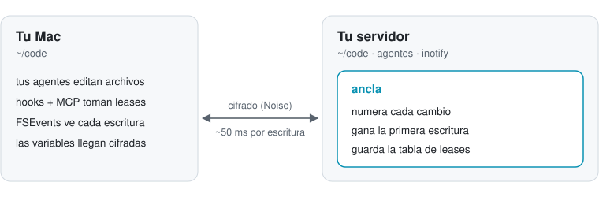

<p align="center">
  
</p>

<p align="center">
  <a href="README.md">English</a> · <b>Español</b>
</p>

<p align="center">
  
</p>

Un agente en tu Mac y otro en tu servidor trabajan cada uno sobre su propia copia del repo. Lo que
cambia uno, el otro no lo ve hasta que alguien hace commit, push y pull. Mientras tanto se pisan,
trabajan sobre código viejo y cada `.env` hay que copiarlo a mano a cada máquina y cada worktree.

hilo vive debajo de tus agentes (Claude Code, Codex, T3 Code, Cursor, OpenCode, cualquier cosa que
escriba archivos) y mantiene las máquinas al día a nivel de archivos y git.

## Para empezar

```sh
curl -fsSL https://raw.githubusercontent.com/damkandev/hilo/main/install.sh | sh
hilo
```

`hilo` te pregunta qué carpeta mantener sincronizada y dónde está tu otra máquina (te muestra los
hosts de `~/.ssh/config`). Después hace el resto por SSH:

1. instala hilo en la otra máquina y la deja como **ancla**
2. empareja las dos máquinas (el código de unión viaja por SSH; nunca lo copias)
3. vincula la carpeta en los dos lados y espera a que todos los repos estén al día
4. instala un servicio en segundo plano, los hooks de Claude Code y el servidor MCP, en ambas

Desde ahí, cada repo de esa carpeta se sincroniza, incluidos los que crees después.

<details>
<summary>Sin el asistente</summary>

```sh
hilo setup devbox --folder ~/code            # lo mismo, sin preguntas

# o a mano, desde la carpeta que quieres vincular:
hilo init --listen 10.0.0.12:7710      # en la máquina que las demás pueden alcanzar
hilo join HILO-7KQ2-M9PA-XR4T@10.0.0.12:7710   # en cada una de las otras
```

</details>

## Qué obtienes

| | |
| --- | --- |
| **Cada escritura, en todas partes** | Un archivo que escribe un agente aparece en la otra máquina en unos 50 ms, con una Wi-Fi de casa. |
| **No se pierde nada** | Si dos máquinas cambian el mismo archivo a la vez, una gana y la versión de la otra queda guardada en una rama `hilo/conflict/<rama>/<fecha>`. |
| **Los agentes se enteran antes** | Antes de que un agente edite un archivo que otro está editando, Claude Code bloquea la edición y le dice quién lo tiene, dónde y por cuánto tiempo. |
| **Ramas y commits** | Los commits viajan con los archivos, las ramas avanzan en todas las máquinas y un worktree nuevo en una aparece en las demás. |
| **Repos nuevos, solos** | Haz `git init` en una carpeta vinculada, el primer commit, y el repo aparece en la otra máquina con su historial y sus archivos sin commitear. |
| **`.env` sin copiar** | Las variables viajan cifradas, clave por clave, y se escriben en cada worktree que las necesita. Una clave puede quedar por máquina o solo en producción. |

## Agentes en la nube

Los agentes que corren en el sandbox de otro (Claude Code en la web, Codex, los background agents
de Cursor, Codespaces, Gitpod, Coder, dev containers) también pueden unirse. Cada sandbox entra como
una máquina de vida corta, y la rama donde trabaja aparece en tu Mac **mientras trabaja**, antes de
cualquier push.

En el ancla, crea un token (o corre `hilo` y elige **Let cloud agents in**):

```sh
hilo token create --addr hilo.example.com:7710        # con --env también reciben los valores de .env
```

Después, en la plataforma:

1. agrega el token como secreto: `HILO_TOKEN=HILO-CLOUD-…@hilo.example.com:7710`
2. agrega una línea a su script de setup:

   ```sh
   curl -fsSL https://raw.githubusercontent.com/damkandev/hilo/main/install.sh | sh -s -- up
   ```

`hilo up` se une con el token, vincula el repo donde se ejecuta, arranca el daemon en segundo plano
(sin systemd ni launchd) y espera a quedar sincronizado. Los sandboxes que solo salen a internet a
través de un proxy funcionan tal cual: hilo pasa por `HTTPS_PROXY` o `ALL_PROXY` (HTTP CONNECT o
SOCKS5), así que Tailscale en modo userspace también sirve.

| | |
| --- | --- |
| **Alcance** | El sandbox tiene que llegar al ancla: usa un VPS como ancla, un puerto abierto en el router o un dominio, y permítelo en la configuración de red de la plataforma. Si la plataforma corta la red al terminar el setup, hilo solo sincroniza durante el setup. |
| **Mismo repo, cualquier clon** | Un repo es su primer commit más `dueño/repo`, así que un clon hecho a través del proxy de git de la plataforma sigue siendo el mismo repo. |
| **Secretos** | Sin `--env`, un sandbox nunca recibe las llaves de la bóveda. Con `--env` recibe la capa compartida; las claves de `hilo env prod` nunca salen de tu máquina. |
| **Limpieza** | Los sandboxes que no se conectan en 7 días se olvidan. `hilo token revoke ID` corta de una vez a todos los que usaron ese token. |

## Cómo funciona

<p align="center">
  <picture>
    <source media="(prefers-color-scheme: dark)" srcset="assets/how-dark.es.svg">
    
  </picture>
</p>

**Un ancla.** Una máquina, normalmente el servidor, le pone un número de secuencia a cada cambio. Las
demás abren una conexión saliente y cifrada hacia ella, así que en tu casa no hace falta abrir
ningún puerto. Con un solo ordenador de cambios, todas las máquinas ven los cambios en el mismo
orden y llegan al mismo estado, sin relojes ni CRDTs.

**La regla.** Cada escritura viaja con el hash de la versión que tenía quien la escribió. El ancla
acepta la primera escritura sobre una versión y rechaza las demás. hilo nunca mezcla dos ediciones:
la máquina que perdió guarda su versión en una rama de conflicto, con `git commit-tree` para no
tocar el worktree, y toma la ganadora. Una simulación determinista (3 máquinas, 400.000 pasos al
azar con conexiones que se caen) comprueba que nada se sobrescribe antes de guardarse.

**Ramas vivas, no carpetas.** Un worktree se identifica por su repo y su rama, no por su ruta:
`~/code/x` en una máquina y `/srv/x` en otra son el mismo repo si comparten su primer commit y su
`origin`. Los commits viajan como bundles de git, después de sus archivos, y las otras máquinas
mueven la rama con `git reset --mixed`, así que el worktree queda limpio.

**Leases.** El hook `PreToolUse` de Claude Code toma un lease de 120 segundos sobre el archivo. El
ancla reparte la tabla de leases, así que el hook responde desde el daemon local en pocos
milisegundos. Los agentes sin hooks usan `claim`, `release` y `who` por MCP. Los leases solo avisan;
lo que protege las escrituras es la regla de arriba.

**Envs.** `.env` y `.env.*` nunca viajan como archivos. Cada clave vive en una bóveda por repo
(ChaCha20-Poly1305) con una capa compartida y otra que nunca sale de la máquina. hilo escribe el
archivo combinado solo donde git lo ignora. Los hooks de Claude Code impiden que los agentes lo lean
con sus herramientas, pero eso es una barrera, no una garantía: una shell igual puede imprimirlo, y
los agentes sin hooks (Codex, Cursor) no tienen ninguna barrera. Cuando eso importa, usa
`env = strict`, que nunca escribe el archivo y solo entrega las variables a los procesos que lances
con `hilo run`, y guarda las llaves de producción con `hilo env prod`.

## Comandos

Solo necesitas `hilo`. Lo demás está para cuando quieras mirar o cambiar algo.

| Comando | |
| --- | --- |
| `hilo` | el asistente; en una máquina ya configurada, un menú |
| `hilo status [--latency]` | máquinas conectadas, carpetas vinculadas, leases, conflictos, aprobaciones pendientes, latencia p50/p95 |
| `hilo add DIR` | vincula otra carpeta (o un solo repo) |
| `hilo env set KEY=valor` · `unset KEY` | cambia una variable en todas partes (`--file apps/web/.env` en monorepos) |
| `hilo env local KEY` | cada máquina guarda su propio valor, por ejemplo `DATABASE_URL` |
| `hilo env prod KEY` | solo en esta máquina, y solo a través de `hilo run` |
| `hilo env ls` · `history [KEY]` · `revert KEY [N]` | capas, las últimas 50 versiones por archivo, volver atrás |
| `hilo run -- npm run dev` | corre con las variables, sin escribir ningún archivo |
| `hilo approve [RUTA \| --all \| --deny RUTA]` | revisa un cambio remoto a una ruta que ejecuta código |
| `hilo trust MÁQUINA read-only` | esa máquina puede leer de esta, pero no escribirle |
| `hilo invite` · `hilo unpair MÁQUINA` | un código de unión nuevo · desconecta una máquina y rota la llave de la bóveda |
| `hilo token create` · `ls` · `revoke ID` | tokens reutilizables para sandboxes en la nube |
| `hilo up` | en el script de setup de un sandbox: une, vincula, arranca y espera a quedar al día |
| `hilo uninstall` | quita el servicio, los hooks y la configuración; tus repos quedan como repos git normales |

La interfaz de la línea de comandos está en inglés.

## Seguridad

- **Emparejamiento:** un código de un solo uso y 10 minutos, mezclado en un handshake `Noise_XXpsk3_25519_ChaChaPoly_SHA256` probado contra los vectores oficiales de cacophony. Después solo se conectan llaves conocidas, y cada lado fija la llave del otro.
- **El ancla** escucha solo en la dirección privada que elijas. Una pública exige `--public`. Antes de que un par se autentique: tope de 1 MiB por frame, 5 segundos para el handshake y como mucho 16 conexiones pendientes.
- **Cada máquina valida cada ruta que recibe.** Rechaza `.git` con cualquier mayúscula o disfraz Unicode, abre cada carpeta con `openat(O_NOFOLLOW)`, crea los temporales con `O_EXCL`, nunca aplica setuid y rechaza nombres que chocan en un disco que no distingue mayúsculas.
- **Las rutas que ejecutan código** (`.claude/`, `.mcp.json`, `.envrc`, `.vscode/`, `.husky/`, `.github/workflows/`, `Makefile`, los `scripts` de `package.json`, `CLAUDE.md`, `AGENTS.md`) esperan a `hilo approve`, que muestra el diff.
- **Los secretos nunca se sincronizan como archivos.** Eso incluye archivos de llaves y formatos de token conocidos (AWS, Stripe live, GitHub, llaves privadas).
- **Las llaves viven en el Keychain de macOS,** y solo el binario firmado de hilo puede leerlas. En Linux viven en `~/.hilo/secrets` con permisos 0600. El socket local nunca devuelve el valor de un secreto.
- **Criptografía:** X25519 y ChaCha20-Poly1305 vienen de crates fijados y vendorizados (`x25519-dalek`, `chacha20poly1305`). SHA-256, HMAC, HKDF y la máquina de estados de Noise están escritos en este repo y verificados contra FIPS 180-4, RFC 4231, RFC 5869 y el vector de cacophony. Tests de fuzzing deterministas comprueban que se rechazan mensajes del handshake y del transporte alterados, truncados, reordenados o repetidos, que quedarse sin nonces es un error y no una reutilización, y que el decodificador resiste 200.000 entradas mutadas. **Nada de esto tiene una auditoría externa.**
- **`unsafe`** solo aparece en los bindings del sistema (FSEvents, inotify, el Keychain, `openat`) y en el SHA-256 por hardware. Todo módulo que procesa datos de la red es `#![forbid(unsafe_code)]`.
- **Cadena de suministro:** `cargo vet` pasa, pero los crates de cripto pasan como excepciones explícitas: no están auditados en este repo. Los crates AEAD de RustCrypto documentan una auditoría de NCC Group (2020); los de dalek no documentan ninguna. `supply-chain/config.toml` dice cuál es cuál.
- **Verificar una descarga:** el instalador revisa el SHA-256, que detecta una descarga corrupta pero viene del mismo release que el binario. La prueba de origen es la atestación de build de GitHub: el instalador la revisa si `gh` tiene sesión, y `HILO_REQUIRE_ATTESTATION=1` la vuelve obligatoria. A mano: `gh attestation verify hilo-<target>.tar.gz --repo damkandev/hilo`.

## Configuración

`~/.hilo/config` es texto plano `clave = valor`. Casi nunca hace falta tocarlo.

| Clave | |
| --- | --- |
| `folder` | una carpeta vinculada (una línea por carpeta) |
| `mirrors` | dónde van las ramas espejadas: por defecto `<repo>.worktrees/<rama>` junto al repo; también una carpeta o `off` |
| `env = strict` | nunca escribe archivos `.env`; las variables solo llegan a `hilo run` |
| `readonly` | máquinas que no pueden escribir aquí (`hilo trust`) |
| `bind` | escucha en una dirección distinta de la que anuncia (NAT, contenedores) |

## Desarrollo

```sh
HILO_KEYCHAIN=0 HILO_NOTIFY=0 cargo test --offline   # incluye la simulación de 400.000 pasos
cargo test -- --ignored keychain                      # usa el Keychain real de tu sesión
cargo vet
```

Un solo binario de Rust de unos 1,5 MB. SHA-256, HMAC, HKDF, Noise, JSON, el formato de red, la
interfaz de terminal y los bindings de FSEvents e inotify están escritos sobre la biblioteca
estándar y llamadas al sistema. `x25519-dalek` y `chacha20poly1305` son los únicos crates.

**Fuera de la v1:** Windows, atravesar NAT (el ancla necesita una dirección que las demás puedan
alcanzar) y sincronizar la conversación del agente.

Licencia MIT.
