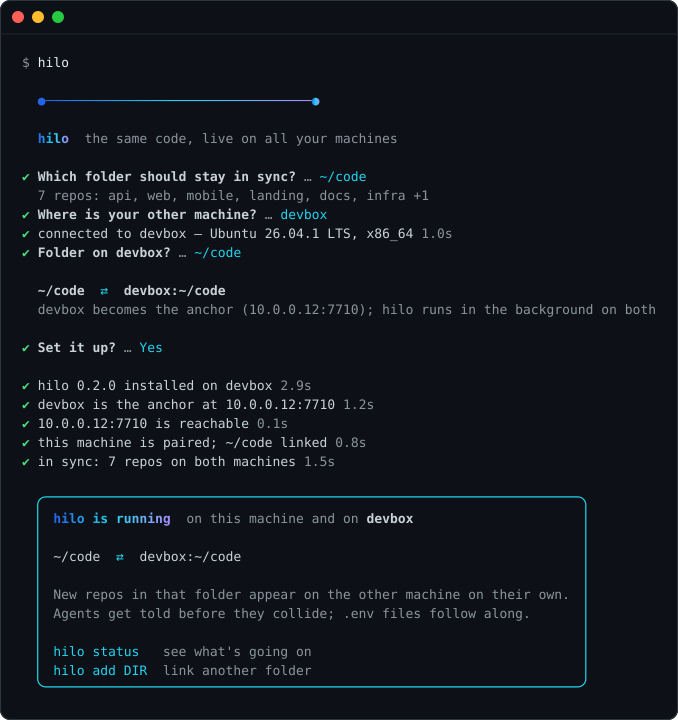

<p align="center">
  
</p>

<p align="center">
  <a href="https://github.com/damkandev/hilo/actions/workflows/ci.yml"></a>
  <a href="https://github.com/damkandev/hilo/releases/latest"></a>
  
  <a href="LICENSE"></a>
</p>

<p align="center">
  <a href="https://hilo.dapan.es"><b>hilo.dapan.es</b></a> · <a href="README.md">English</a> · <b>Español</b>
</p>

<p align="center">
  <b>Un drive compartido para tus agentes, en tus propias máquinas.</b><br>
  Repos vivos, cualquier carpeta, cada versión guardada, archivos por MCP, una carpeta por sandbox.<br>
  Gratis, MIT, sin cuenta y sin el servidor de nadie más.
</p>

<p align="center">
  
</p>

Tus agentes corren en más de una máquina: Claude Code en tu Mac, Codex en un servidor, un sandbox en
la nube. Cada uno trabaja sobre su propia copia del código y de todo lo que lo rodea. Lo que escribe
uno, los otros no lo ven hasta que alguien hace commit, push y pull. Las specs, las notas y los
reportes se pasan copiando y pegando, cada `.env` se copia a mano, y dos agentes que editan el mismo
archivo se pisan sin que nadie se entere.

hilo vive debajo de tus agentes (Claude Code, Codex, T3 Code, Cursor, OpenCode, cualquier cosa que
escriba archivos) y les da un solo drive:

- **Los repos quedan vivos en todas partes.** Una escritura aparece en tus otras máquinas en
  milisegundos, con su rama, sus commits y sus archivos sin commitear.
- **Cualquier otra carpeta también se sincroniza.** Notas, specs, memoria de agentes, CSV y JSON,
  iguales en todas las máquinas.
- **Nunca se pierde nada.** Antes de sobrescribir o borrar un archivo, hilo guarda la versión
  anterior. ¿Dos agentes escriben a la vez? Uno gana, la versión del otro queda guardada y su agente
  se entera.
- **Los agentes sin disco también entran.** Por MCP leen, escriben, listan y buscan en el drive.
- **Un sandbox en la nube recibe una sola carpeta.** Con alcance, con vencimiento y de solo lectura si
  quieres: nunca ve el resto.

## Para empezar

```sh
curl -fsSL https://raw.githubusercontent.com/damkandev/hilo/main/install.sh | sh
hilo
```

En Windows, compílalo con `cargo build --release` y pon `target\release\hilo.exe` en tu PATH
(mira [Despliegue](docs/deployment.es.md#windows)).

`hilo` te pregunta qué carpeta mantener sincronizada y dónde está tu otra máquina (te muestra los
hosts de `~/.ssh/config`). Después hace el resto por SSH:

1. instala hilo en la otra máquina y la deja como **ancla**
2. empareja las dos máquinas (el código de unión viaja por SSH; nunca lo copias)
3. vincula la carpeta en los dos lados y espera a que todos los repos estén al día
4. instala un servicio en segundo plano, los hooks de Claude Code y el servidor MCP, en ambas

Desde ahí, cada repo de esa carpeta se sincroniza, incluidos los que crees después.

<details>
<summary>Sin el asistente</summary>

```sh
hilo setup devbox --folder ~/code            # lo mismo, sin preguntas

# o a mano, desde la carpeta que quieres vincular:
hilo init --listen 10.0.0.12:7710      # en la máquina que las demás pueden alcanzar
hilo join HILO-7KQ2-M9PA-XR4T@10.0.0.12:7710   # en cada una de las otras
```

Mira [Despliegue](docs/deployment.es.md) para direcciones, servicios y plataformas.

</details>

<details>
<summary>La app para Mac</summary>

`hilo.app` mantiene una carpeta compartida en tu Escritorio, `~/Desktop/hilo`. La abres, eliges tu
otra máquina de `~/.ssh/config` (o pegas un código de unión) y esa carpeta tiene los mismos archivos en
las dos. Desde la app también ves quién está conectado, agregas y quitas carpetas, traes de vuelta
cualquier versión de un archivo y recuperas los borrados. Usa el CLI `hilo` que viene adentro. Se arma
con `app/bundle.sh`, que también genera el `.dmg`; Windows viene después.

</details>

## hilo drive

El código es la mitad de lo que comparten los agentes. La otra mitad es el contexto: la spec que
escribió uno, el reporte que dejó otro, el CSV que están llenando tres. Convierte cualquier carpeta
en un drive y vive en todas tus máquinas, con todo su historial.

```sh
hilo add --drive ~/notas                    # en cada máquina que deba tenerla

hilo log ~/notas/plan.md                    # cada versión de un archivo, quién la escribió y cuándo
hilo restore ~/notas/plan.md --conflict     # tu versión, si otro agente guardó primero
hilo trash ~/notas                          # archivos borrados que puedes recuperar
hilo grep "acme" ~/notas                    # busca en todo lo que se sincroniza

hilo token create --path ~/notas/clientes --expires 7d --read-only   # una carpeta, para un sandbox
```

| | |
| --- | --- |
| **Contexto compartido** | Notas, specs, memoria de agentes, reportes y datos, iguales en tu Mac y en tu servidor. Medido en una red de casa: un cambio llega a la otra máquina en 5 ms (p50). |
| **Relevos entre agentes** | Un agente en el servidor deja un reporte en `reportes/`; el de tu Mac lo lee un momento después. Sin copiar, sin subir nada. |
| **Cada versión, recuperable** | Cada versión que ve hilo queda guardada por su hash durante 30 días (o 5 GB): ediciones, borrados, la versión que perdió un conflicto. `hilo restore` trae de vuelta cualquiera. También funciona en repos, para archivos que nunca commiteaste. |
| **Seguro por defecto** | Respeta `.gitignore`, y los `.env` y las llaves nunca salen de la máquina. Una carpeta drive que desaparece (un disco desmontado, una carpeta movida y recreada) se pausa en vez de borrar tus archivos en todas partes. La carpeta de hilo nunca se sincroniza. |
| **Búsqueda** | `hilo grep`, y `search` por MCP, buscan exactamente en los archivos que se sincronizan, nunca en los ignorados. |

## Qué obtienes

| | |
| --- | --- |
| **Cada escritura, en todas partes** | Un archivo que escribe un agente aparece en tus otras máquinas en milisegundos, en repos y en drives. |
| **No se pierde nada** | Si dos máquinas cambian el mismo archivo a la vez, una gana y la versión de la otra queda guardada: en una rama `hilo/conflict/<rama>/<fecha>` si es un repo, en el historial de hilo si es un drive. Al agente que perdió se le dice dónde quedó su versión. |
| **Los agentes se enteran antes** | Antes de que un agente edite un archivo que otro está editando, Claude Code bloquea la edición y le dice quién lo tiene, dónde y por cuánto tiempo. |
| **Ramas y commits** | Los commits viajan con los archivos, las ramas avanzan en todas las máquinas y un worktree nuevo en una aparece en las demás. |
| **Repos nuevos, solos** | Haz `git init` en una carpeta vinculada, el primer commit, y el repo aparece en la otra máquina con su historial y sus archivos sin commitear. |
| **Agentes sin hooks ni disco** | `hilo mcp` le da a cualquier agente `read`, `write`, `list` y `search` sobre las carpetas sincronizadas, y sobre nada fuera de ellas. Un `write` toma el lease y se sincroniza al instante. |
| **`.env` sin copiar** | Las variables viajan cifradas, clave por clave, y se escriben en cada worktree que las necesita. Una clave puede quedar por máquina o solo en producción. |
| **Agentes en la nube, con correa** | Los sandboxes de Claude Code en la web, Codex, Cursor y Codespaces se unen con un token, y su trabajo aparece en tu Mac mientras lo hacen. Un token puede limitarse a una carpeta, vencer solo y ser de solo lectura. El ancla filtra todo lo que le manda, y el sandbox conoce sus límites y lo dice. [Cómo →](docs/cloud-agents.es.md) |

## Local, no la nube de otro

| | hilo | Un drive alojado para agentes |
| --- | --- | --- |
| Dónde viven tus archivos | en tus máquinas | en los servidores del proveedor |
| Precio | gratis, sin tope de espacio: el límite es tu disco | por gigabyte o por asiento |
| Cuenta | ninguna | obligatoria |
| Git | ramas, commits y worktrees siguen vivos | solo archivos |
| `.env` y secretos | una bóveda cifrada; los archivos de secretos nunca se sincronizan | no los maneja |
| Funciona sin internet, en tu red local | sí | no |

## Cómo funciona

<p align="center">
  <picture>
    <source media="(prefers-color-scheme: dark)" srcset="assets/how-dark.es.svg">
    
  </picture>
</p>

Una máquina, el **ancla**, le pone un número de secuencia a cada cambio; las demás se conectan a
ella con una conexión saliente y cifrada. Cada escritura lleva el hash de la versión sobre la que se
hizo, y el ancla acepta solo la primera escritura sobre cada versión. La edición que pierde nunca se
mezcla ni se descarta: primero se guarda, en una rama de conflicto si es un repo o en el historial de
hilo si es un drive, y recién entonces se reemplaza. [Más detalle →](docs/architecture.es.md)

## Documentación

| | |
| --- | --- |
| [Arquitectura](docs/architecture.es.md) | el ancla, la regla de escritura, ramas vivas, carpetas drive, historial, leases, la bóveda de `.env` |
| [Agentes en la nube](docs/cloud-agents.es.md) | tokens, tokens con alcance y de solo lectura, `hilo up`, proxies, qué puede ver un sandbox |
| [Comandos y configuración](docs/commands.es.md) | cada comando, herramientas MCP, `~/.hilo/config`, variables de entorno |
| [Despliegue](docs/deployment.es.md) | elegir el ancla, direcciones, servicios en segundo plano, archivos, plataformas |
| [Seguridad](SECURITY.es.md) | red, archivos, llaves, tokens con alcance, criptografía, cadena de suministro, verificar descargas, reportes |
| [Contribuir](CONTRIBUTING.es.md) | compilar, testear, CI y releases |

## Estado

hilo es joven (v0.3) y no tiene auditoría de seguridad externa. Un solo binario de Rust de unos
1,8 MB (2,1 MB en Linux); los únicos crates son de criptografía. Cada cambio pasa por una simulación
determinista de 400.000 pasos y por un script de punta a punta que corre daemons reales.

**Todavía no:** Windows; atravesar NAT (el ancla necesita una dirección que las demás puedan
alcanzar); mezclar dos ediciones del mismo archivo (hilo guarda ambas y nunca mezcla); drives que
aparezcan solos en máquinas nuevas (se agregan en cada una); sincronizar la conversación del agente.

## Licencia

[MIT](LICENSE)
