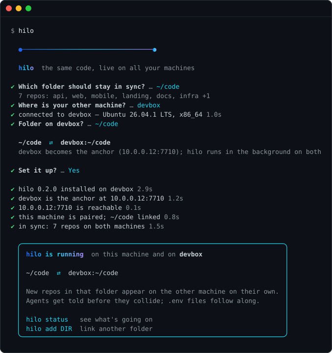
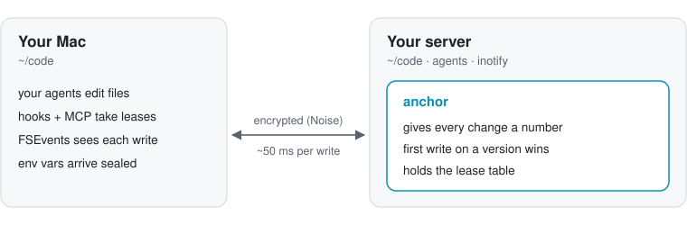

<p align="center">
  
</p>

<p align="center">
  <a href="https://github.com/damkandev/hilo/actions/workflows/ci.yml"></a>
  <a href="https://github.com/damkandev/hilo/releases/latest"></a>
  
  <a href="LICENSE"></a>
</p>

<p align="center">
  <b>English</b> · <a href="README.es.md">Español</a>
</p>

<p align="center">
  
</p>

An agent on your Mac and another on your server each work on their own copy of the repo. What one
changes, the other doesn't see until someone commits, pushes and pulls. Meanwhile they step on each
other, work on stale code, and every `.env` has to be copied by hand to every machine and worktree.

hilo sits underneath your agents (Claude Code, Codex, T3 Code, Cursor, OpenCode, anything that writes
files) and keeps the machines in step at the level of files and git. It also works as a shared drive
for agents: any folder, with history, search and file tools over MCP, on your own machines.

## Get started

```sh
curl -fsSL https://raw.githubusercontent.com/damkandev/hilo/main/install.sh | sh
hilo
```

`hilo` asks which folder to keep in sync and where your other machine is (it lists the hosts in
`~/.ssh/config`). Then it does the rest over SSH:

1. installs hilo on the other machine and starts it as the **anchor**
2. pairs both machines (the join code travels over SSH; you never copy it)
3. links the folder on both sides and waits until every repo is in sync
4. installs a background service, the Claude Code hooks and the MCP server, on both

From then on, every repo in that folder syncs, including the ones you create later.

<details>
<summary>Without the wizard</summary>

```sh
hilo setup devbox --folder ~/code            # same thing, no questions

# or by hand, from the folder you want to link:
hilo init --listen 10.0.0.12:7710      # on the machine the others can reach
hilo join HILO-7KQ2-M9PA-XR4T@10.0.0.12:7710   # on every other machine
```

See [Deployment](docs/deployment.md) for addresses, services and platforms.

</details>

## What you get

| | |
| --- | --- |
| **Every write, everywhere** | A file an agent writes appears on the other machine in about 50 ms on a home Wi-Fi. |
| **Nothing is lost** | If two machines change the same file at once, one wins and the other's version is kept: on a `hilo/conflict/<branch>/<date>` branch in a repo, and in hilo's history everywhere. Every version hilo overwrites or deletes stays recoverable with `hilo log`, `hilo restore` and `hilo trash` (30 days by default). |
| **Agents hear about it first** | Before an agent edits a file another agent is editing, Claude Code blocks the edit and tells it who has the file, where, and for how long. |
| **Branches and commits** | Commits travel with the files, branches move on every machine, and a new worktree on one machine appears on the others. |
| **New repos on their own** | `git init` a repo in a linked folder, make the first commit, and it shows up on the other machine with its history and uncommitted files. |
| **Plain folders too** | `hilo add --drive ~/notes` makes any folder a [drive](docs/architecture.md#drive-folders): notes, specs, CSV and JSON that agents share, synced as they are, `.gitignore` respected, `.env` never sent. |
| **Agents without hooks or a disk** | Over MCP, any agent can `read`, `write`, `list` and `search` the synced folders, and nothing outside them. `hilo grep` searches the whole drive from the terminal. |
| **`.env` without copying** | Variables are encrypted, synced key by key, and written into every worktree that needs them. Keys can stay per machine or production-only. |
| **Cloud agents too** | Claude Code on the web, Codex, Cursor and Codespaces sandboxes join with a token, and their branch shows up on your Mac while they work. A token can be limited to one folder, expire on its own and be read-only: the sandbox never sees the rest. [How →](docs/cloud-agents.md) |

## How it works

<p align="center">
  <picture>
    <source media="(prefers-color-scheme: dark)" srcset="assets/how-dark.svg">
    
  </picture>
</p>

One machine, the **anchor**, gives every change a sequence number; the others connect to it over an
encrypted, outgoing connection. A write carries the hash of the version it was based on, and the
anchor accepts only the first write on each version. The loser's edit is never merged or dropped:
it's saved on a conflict branch. [Read more →](docs/architecture.md)

## Documentation

| | |
| --- | --- |
| [Architecture](docs/architecture.md) | the anchor, the write rule, live branches, drive folders, history, leases, the `.env` vault |
| [Cloud agents](docs/cloud-agents.md) | tokens, scoped and read-only tokens, `hilo up`, proxies, what a sandbox can see |
| [Commands and configuration](docs/commands.md) | every command, MCP tools, `~/.hilo/config`, environment variables |
| [Deployment](docs/deployment.md) | choosing the anchor, addresses, background services, files, platforms |
| [Security](SECURITY.md) | network, files, keys, cryptography, supply chain, verifying downloads, reporting |
| [Contributing](CONTRIBUTING.md) | building, testing, CI and releases |

## Status

hilo is young (v0.3) and has had no external security audit. One Rust binary of about 1.8 MB
(2.1 MB on Linux); the only crates are for cryptography.

**Not in v1:** Windows, NAT traversal (the anchor needs an address the others can reach), and syncing
the agent's conversation.

## License

[MIT](LICENSE)
