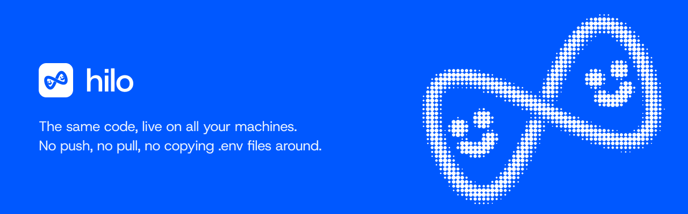

<p align="center">
  
</p>

<p align="center">
  <a href="https://github.com/damkandev/hilo/actions/workflows/ci.yml"></a>
  <a href="https://github.com/damkandev/hilo/releases/latest"></a>
  
  <a href="LICENSE"></a>
</p>

<p align="center">
  <a href="https://hilo.dapan.es"><b>hilo.dapan.es</b></a> · <b>English</b> · <a href="README.es.md">Español</a>
</p>

<p align="center">
  <b>A shared drive for your agents, on your own machines.</b><br>
  Live repos, any folder, every version kept, file tools over MCP, one folder per cloud sandbox.<br>
  Free, MIT, no account, and no one else's server.
</p>

<p align="center">
  
</p>

Your agents run on more than one machine: Claude Code on your Mac, Codex on a server, a sandbox in
the cloud. Each one works on its own copy of the code and of everything around it. What one writes,
the others don't see until someone commits, pushes and pulls. Specs, notes and reports get pasted
from one to the other, every `.env` is copied by hand, and two agents editing the same file quietly
overwrite each other.

hilo sits underneath your agents (Claude Code, Codex, T3 Code, Cursor, OpenCode, anything that writes
files) and gives them one drive:

- **Repos stay live everywhere.** A write shows up on your other machines in milliseconds, with its
  branch, its commits and its uncommitted files.
- **Any other folder syncs too.** Notes, specs, agent memory, CSV and JSON, the same on every machine.
- **Nothing is ever lost.** Before hilo overwrites or deletes a file, it keeps the old version.
  Two agents writing at once? One wins, the other's version is saved and its agent is told.
- **Agents without a disk still get in.** Over MCP they read, write, list and search the drive.
- **A cloud sandbox gets one folder.** Scoped, expiring, read-only if you want: it never sees the rest.

## Get started

```sh
curl -fsSL https://raw.githubusercontent.com/damkandev/hilo/main/install.sh | sh
hilo
```

On Windows, build it with `cargo build --release` and put `target\release\hilo.exe` on your PATH
(see [Deployment](docs/deployment.md#windows)).

`hilo` asks which folder to keep in sync and where your other machine is (it lists the hosts in
`~/.ssh/config`). Then it does the rest over SSH:

1. installs hilo on the other machine and starts it as the **anchor**
2. pairs both machines (the join code travels over SSH; you never copy it)
3. links the folder on both sides and waits until every repo is in sync
4. installs a background service, the Claude Code hooks and the MCP server, on both

From then on, every repo in that folder syncs, including the ones you create later.

<details>
<summary>Without the wizard</summary>

```sh
hilo setup devbox --folder ~/code            # same thing, no questions

# or by hand, from the folder you want to link:
hilo init --listen 10.0.0.12:7710      # on the machine the others can reach
hilo join HILO-7KQ2-M9PA-XR4T@10.0.0.12:7710   # on every other machine
```

See [Deployment](docs/deployment.md) for addresses, services and platforms.

</details>

<details>
<summary>The Mac app</summary>

`hilo.app` keeps a shared folder on your Desktop, `~/Desktop/hilo`. Open it, pick your other machine
from `~/.ssh/config` (or paste a join code), and that folder holds the same files on both. From the
app you also see who's online, add and remove folders, bring back any version of a file and restore
deleted ones. It runs the `hilo` CLI that ships inside it. Build it with `app/bundle.sh`, which also
makes the `.dmg`; each release has it as `hilo-macos.dmg` (Apple silicon). Windows comes later.

</details>

## hilo drive

Code is half of what agents share. The other half is context: the spec one agent wrote, the report
another left behind, the CSV three of them are filling in. Make any folder a drive and it lives on
every machine, with its whole history.

```sh
hilo add --drive ~/notes                    # on each machine that should have it

hilo log ~/notes/plan.md                    # every version of a file, who wrote it, when
hilo restore ~/notes/plan.md --conflict     # your version, if another agent saved first
hilo trash ~/notes                          # deleted files you can bring back
hilo grep "acme" ~/notes                    # search everything that syncs

hilo token create --path ~/notes/clients --expires 7d --read-only   # one folder, for one sandbox
```

| | |
| --- | --- |
| **Shared context** | Notes, specs, agent memory, reports and data, the same on your Mac and your server. Measured on a home network: a change lands on the other machine in 5 ms (p50). |
| **Handoffs between agents** | An agent on the server leaves a report in `reports/`; the one on your Mac reads it a moment later. No copy step, no upload. |
| **Every version, recoverable** | Each version hilo sees is kept by its hash for 30 days (or 5 GB): edits, deletions, the version that lost a conflict. `hilo restore` brings any of them back. It works in repos too, for files you never committed. |
| **Safe by default** | `.gitignore` is respected and `.env` files and keys never leave the machine. A drive folder that vanishes (an unmounted disk, a folder moved and recreated) pauses instead of deleting your files everywhere. hilo's own folder never syncs. |
| **Search** | `hilo grep`, and `search` over MCP, look through exactly the files that sync, never the ignored ones. |

## What you get

| | |
| --- | --- |
| **Every write, everywhere** | A file an agent writes appears on your other machines in milliseconds, in repos and drives alike. |
| **Nothing is lost** | If two machines change the same file at once, one wins and the other's version is kept: on a `hilo/conflict/<branch>/<date>` branch in a repo, in hilo's history in a drive. The agent that lost is told where its version is. |
| **Agents hear about it first** | Before an agent edits a file another agent is editing, Claude Code blocks the edit and tells it who has the file, where, and for how long. |
| **Branches and commits** | Commits travel with the files, branches move on every machine, and a new worktree on one machine appears on the others. |
| **New repos on their own** | `git init` a repo in a linked folder, make the first commit, and it shows up on the other machine with its history and uncommitted files. |
| **Agents without hooks or a disk** | `hilo mcp` gives any agent `read`, `write`, `list` and `search` on the synced folders, and nothing outside them. A `write` takes the lease and syncs at once. |
| **`.env` without copying** | Variables are encrypted, synced key by key, and written into every worktree that needs them. Keys can stay per machine or production-only. |
| **Cloud agents, on a leash** | Claude Code on the web, Codex, Cursor and Codespaces sandboxes join with a token, and their work shows up on your Mac while they do it. A token can be limited to one folder, expire on its own and be read-only. The anchor filters everything it sends, and the sandbox knows its limits and says so. [How →](docs/cloud-agents.md) |

## Local, not someone's cloud

| | hilo | A hosted drive for agents |
| --- | --- | --- |
| Where your files live | on your machines | on the provider's servers |
| Price | free, no storage cap: your disk is the limit | by the gigabyte or by the seat |
| Account | none | required |
| Git | branches, commits and worktrees stay live | files only |
| `.env` and secrets | an encrypted vault; secret files never sync | not handled |
| Works offline, on your LAN | yes | no |

## How it works

<p align="center">
  <picture>
    <source media="(prefers-color-scheme: dark)" srcset="assets/how-dark.svg">
    
  </picture>
</p>

One machine, the **anchor**, gives every change a sequence number; the others connect to it over an
encrypted, outgoing connection. A write carries the hash of the version it was based on, and the
anchor accepts only the first write on each version. The loser's edit is never merged or dropped:
it's saved first, on a conflict branch in a repo or in hilo's history in a drive, and only then
replaced. [Read more →](docs/architecture.md)

## Documentation

| | |
| --- | --- |
| [Architecture](docs/architecture.md) | the anchor, the write rule, live branches, drive folders, history, leases, the `.env` vault |
| [Cloud agents](docs/cloud-agents.md) | tokens, scoped and read-only tokens, `hilo up`, proxies, what a sandbox can see |
| [Commands and configuration](docs/commands.md) | every command, MCP tools, `~/.hilo/config`, environment variables |
| [Deployment](docs/deployment.md) | choosing the anchor, addresses, background services, files, platforms |
| [Security](SECURITY.md) | network, files, keys, scoped tokens, cryptography, supply chain, verifying downloads, reporting |
| [Contributing](CONTRIBUTING.md) | building, testing, CI and releases |

## Status

hilo is young (v0.3) and has had no external security audit. One Rust binary of about 1.8 MB
(2.1 MB on Linux); the only crates are for cryptography. Every change is checked by a deterministic
simulation of 400,000 steps and an end-to-end script that runs real daemons.

**Not yet:** Windows; NAT traversal (the anchor needs an address the others can reach); merging two
edits of the same file (hilo keeps both and never merges); drives appearing on their own on new
machines (add them on each); syncing the agent's conversation.

## License

[MIT](LICENSE)
