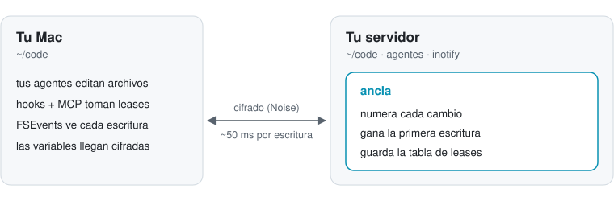
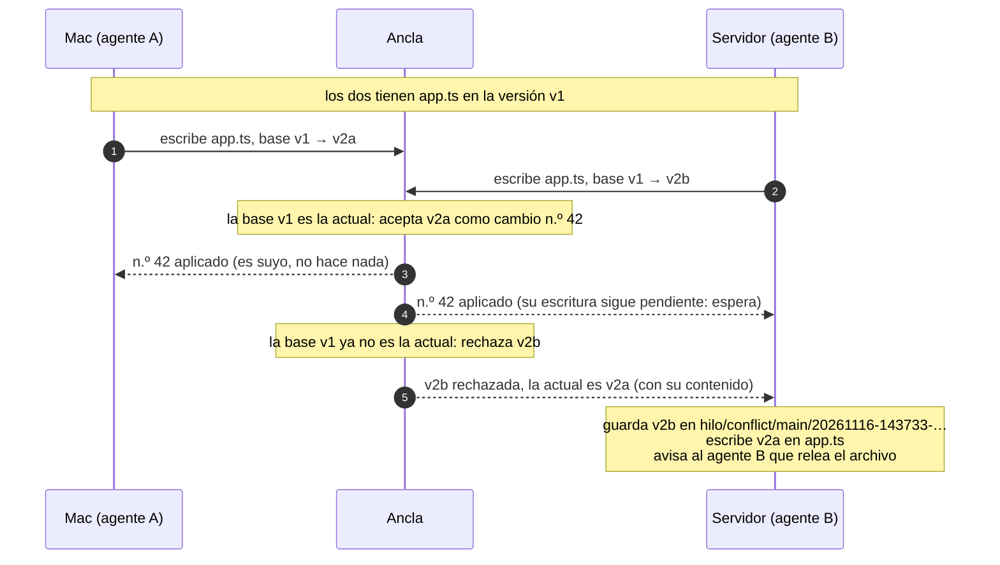
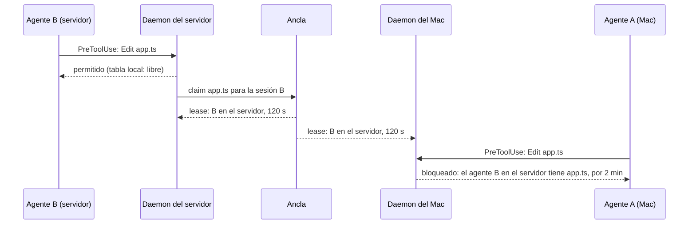
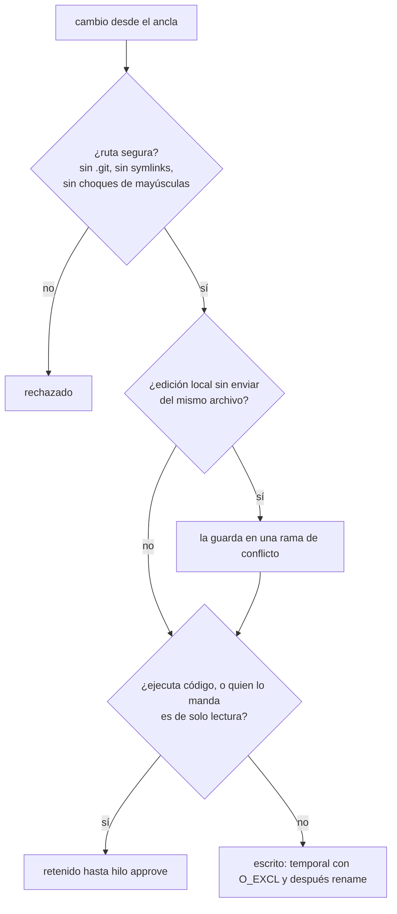

# Cómo funciona hilo

  <a href="architecture.md">English</a> · <b>Español</b>

  <picture>
    <source media="(prefers-color-scheme: dark)" srcset="../assets/how-dark.es.svg">
    
  </picture>

## Un ancla

Una máquina, normalmente el servidor, le pone un número de secuencia a cada cambio. Las demás abren
una conexión saliente y cifrada hacia ella, así que en tu casa no hace falta abrir ningún puerto. Con
un solo ordenador de cambios, todas las máquinas ven los cambios en el mismo orden y llegan al mismo
estado, sin relojes ni CRDTs.

## La regla

Cada escritura viaja con el hash de la versión que tenía quien la escribió. El ancla acepta la
primera escritura sobre una versión y rechaza las demás. hilo nunca mezcla dos ediciones: la máquina
que perdió guarda su versión en una rama `hilo/conflict/<rama>/<fecha>`, con `git commit-tree` para
no tocar el worktree, y toma la ganadora.

La máquina que perdió hace tres cosas, en este orden:

1. **Guarda su versión** con `git commit-tree` en `hilo/conflict/<rama>/<fecha>`, sin tocar el
   worktree ni la rama. Si el contenido ya está en `HEAD` no hay nada que perder y se lo salta. Si no
   logra guardarla, deja el archivo como está: nunca sobrescribe lo que no pudo guardar.
2. **Escribe la ganadora** en el archivo.
3. **Avisa al agente** que escribió la versión perdedora, en su sesión: quién ganó, dónde quedó su
   versión (`git show <rama>:<ruta>`) y que relea el archivo antes de volver a editarlo.

`hilo status` cuenta las ramas guardadas; `git branch --list 'hilo/conflict/*'` las lista. Con 500
ramas guardadas, un repo deja de guardar nuevas (y por eso deja quietos los archivos en conflicto)
hasta que borres las viejas.

Una máquina que estuvo desconectada funciona igual. Al reconectarse le dice al ancla el último número
de cambio que vio, recibe todo lo posterior y después reenvía las escrituras que el ancla nunca
recibió. Cada una sigue llevando su base, así que una escritura hecha sin conexión sobre un archivo
que cambió mientras tanto termina en una rama de conflicto, no encima de la versión más nueva.

Una simulación determinista (3 máquinas, 400.000 pasos al azar con conexiones que se caen) comprueba
que nada se sobrescribe antes de guardarse.

## Ramas vivas, no carpetas

Un worktree se identifica por su repo y su rama, no por su ruta: `~/code/x` en una máquina y `/srv/x`
en otra son el mismo repo si comparten su primer commit y su `origin`. Los commits viajan como
bundles de git, después de sus archivos, y las otras máquinas mueven la rama con `git reset --mixed`,
así que el worktree queda limpio.

Un worktree nuevo en una máquina aparece en las demás, por defecto en `<repo>.worktrees/<rama>` junto
al repo (ver [`mirrors`](commands.es.md#configuración)). Un repo creado con `git init` en una carpeta
vinculada aparece en las otras máquinas después de su primer commit, con su historial y sus archivos
sin commitear.

## Leases

El hook `PreToolUse` de Claude Code toma un lease de 120 segundos sobre el archivo. El ancla reparte
la tabla de leases, así que el hook responde desde el daemon local en pocos milisegundos. Los agentes
sin hooks (Codex, Cursor, OpenCode) usan `claim`, `release` y `who` por MCP.

El daemon local concede al tiro un archivo libre y le avisa al ancla; el ancla tiene la última
palabra y reparte el resultado. Cada edición (`PostToolUse`) renueva el lease, y los leases de la
sesión se liberan cuando el agente termina. Si el daemon está caído, los hooks dejan pasar la
edición.

Los leases solo avisan; lo que protege las escrituras es [la regla](#la-regla).

## Recibir un cambio

Cada máquina decide por su cuenta si aplica lo que le manda el ancla:

Las rutas que ejecutan código están en [SECURITY.es.md](../SECURITY.es.md#archivos). En
`package.json`, solo un cambio en `scripts` espera aprobación.

## Envs

`.env` y `.env.*` nunca viajan como archivos. Cada clave vive en una bóveda por repo
(ChaCha20-Poly1305) con dos capas:

- **compartida:** se sincroniza a todas las máquinas, y a los sandboxes cuyo token tiene `--env`
- **local:** nunca sale de la máquina (`hilo env local KEY`, `hilo env prod KEY`)

hilo escribe el archivo combinado solo donde git lo ignora. Los hooks de Claude Code impiden que los
agentes lo lean con sus herramientas, pero eso es una barrera, no una garantía: una shell igual puede
imprimirlo, y los agentes sin hooks (Codex, Cursor) no tienen ninguna barrera. Cuando eso importa,
usa `env = strict`, que nunca escribe el archivo y solo entrega las variables a los procesos que
lances con `hilo run`, y guarda las llaves de producción con `hilo env prod`.

## El binario

Un solo binario de Rust de unos 1,6 MB. JSON, el formato de red, la interfaz de terminal y los
bindings de FSEvents e inotify están escritos sobre la biblioteca estándar y llamadas al sistema. Los
únicos crates son de criptografía: `snow`, `x25519-dalek`, `chacha20poly1305`, `sha2` y `hkdf`. Mira
[SECURITY.es.md](../SECURITY.es.md) para saber cómo se fijan y se verifican.

| Módulo | |
| --- | --- |
| `anchor.rs` | ordena los cambios, acepta o rechaza escrituras, reparte los leases |
| `daemon.rs` | vigila las carpetas vinculadas, aplica cambios remotos, espeja ramas |
| `sync.rs` · `git.rs` | transferencia de archivos y commits, ramas de conflicto, bundles |
| `watch.rs` · `scan.rs` · `fsops.rs` | FSEvents e inotify, escaneo, manejo seguro de rutas |
| `net.rs` · `noise.rs` · `wire.rs` · `crypto.rs` | conexiones y proxies, el canal Noise, el framing |
| `vault.rs` · `secret.rs` | la bóveda de `.env`, el Keychain y `~/.hilo/secrets` |
| `lease.rs` · `hooks.rs` · `mcp.rs` | leases, hooks de Claude Code, el servidor MCP |
| `setup.rs` · `install.rs` · `tui.rs` | el asistente, los servicios en segundo plano, la interfaz de terminal |
