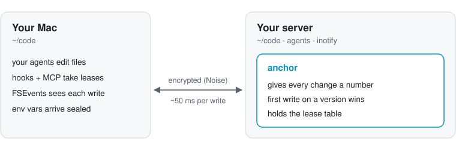
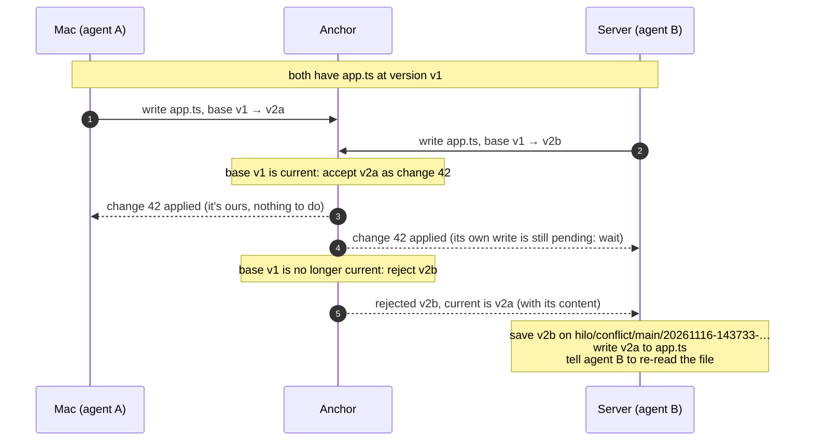
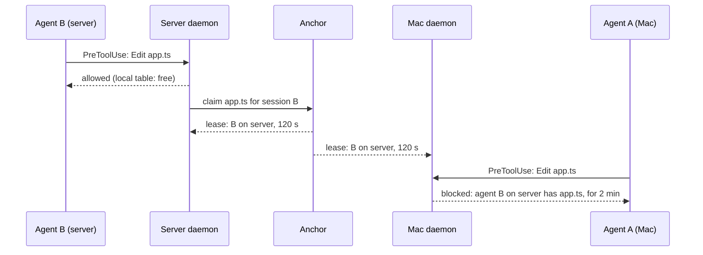
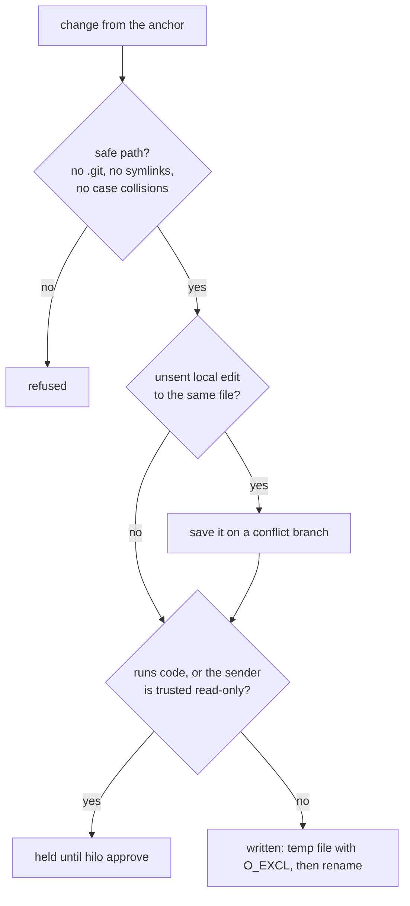

# How hilo works

  <b>English</b> · <a href="architecture.es.md">Español</a>

  <picture>
    <source media="(prefers-color-scheme: dark)" srcset="../assets/how-dark.svg">
    
  </picture>

## One anchor

One machine, usually the server, gives every change a sequence number. The others open an outgoing,
encrypted connection to it, so nothing needs an open port at home. With a single orderer every
machine sees changes in the same order and converges, without clocks or CRDTs.

## The rule

A write travels with the hash of the version its writer had. The anchor accepts the first write on
a version and rejects the rest. hilo never merges two edits: the machine that lost saves its version
on a `hilo/conflict/<branch>/<date>` branch, with `git commit-tree` so the worktree isn't touched,
and takes the winner.

The machine that lost does three things, in this order:

1. **Saves its version** with `git commit-tree` on `hilo/conflict/<branch>/<date>`, without touching
   the worktree or the branch. If the content is already in `HEAD` there's nothing to lose and it
   skips this. If saving fails, it leaves the file alone: it never overwrites what it couldn't save.
2. **Writes the winner** to the file.
3. **Tells the agent** that wrote the losing version, in its session: who won, where its version is
   (`git show <branch>:<path>`), and to re-read the file before editing again.

`hilo status` counts the saved branches; `git branch --list 'hilo/conflict/*'` lists them. At 500
saved branches a repo stops saving new ones (and so leaves conflicting files alone) until you delete
old ones.

A machine that was offline works the same way. When it reconnects it tells the anchor the last change
number it saw, receives everything after it, and then resends the writes the anchor never got. Each
one still carries its base, so a write made offline on a file that changed meanwhile ends up on a
conflict branch, not on top of the newer version.

A deterministic simulation (3 machines, 400,000 random steps with dropped connections) checks that
nothing is ever overwritten before it's saved.

## Live branches, not folders

A worktree is identified by its repo and branch, not its path: `~/code/x` on one machine and `/srv/x`
on another are the same repo if they share their first commit and `origin`. Commits travel as git
bundles, after their files, and the other machines move the branch with `git reset --mixed`, so the
worktree stays clean.

A new worktree on one machine appears on the others, by default in `<repo>.worktrees/<branch>` next
to the repo (see [`mirrors`](commands.md#configuration)). A repo created with `git init` in a linked
folder shows up on the other machines after its first commit, with its history and uncommitted
files.

## Leases

Claude Code's `PreToolUse` hook takes a 120-second lease on the file. The anchor broadcasts the lease
table, so the hook answers from the local daemon in a few milliseconds. Agents without hooks
(Codex, Cursor, OpenCode) use `claim`, `release` and `who` over MCP.

The local daemon grants a free file at once and tells the anchor; the anchor has the last word and
broadcasts the result. Each edit (`PostToolUse`) renews the lease, and the session's leases are
released when the agent stops. If the daemon is down, the hooks let the edit through.

Leases only warn; [the rule](#the-rule) is what keeps writes safe.

## Receiving a change

Every machine decides on its own whether to apply what the anchor sends:

Paths that run code are listed in [SECURITY.md](../SECURITY.md#files). For `package.json`, only a
change to `scripts` waits for approval.

## Envs

`.env` and `.env.*` never travel as files. Each key lives in a per-repo vault (ChaCha20-Poly1305)
with two layers:

- **shared:** synced to every machine, and to cloud sandboxes whose token has `--env`
- **local:** never leaves the machine (`hilo env local KEY`, `hilo env prod KEY`)

hilo writes the merged file only where git ignores it. Claude Code's hooks stop agents from reading
it with their tools, but that's a barrier, not a guarantee: a shell can still print it, and agents
without hooks (Codex, Cursor) have no barrier at all. When that matters, set `env = strict` so no
file is ever written and variables only reach processes started with `hilo run`, and keep
production keys in `hilo env prod`.

## The binary

One Rust binary of about 1.6 MB. JSON, the wire format, the terminal UI and the FSEvents and inotify
bindings are written against the standard library and system calls. The only crates are for
cryptography: `snow`, `x25519-dalek`, `chacha20poly1305`, `sha2` and `hkdf`. See
[SECURITY.md](../SECURITY.md) for how they're pinned and checked.

| Module | |
| --- | --- |
| `anchor.rs` | orders changes, accepts or rejects writes, broadcasts leases |
| `daemon.rs` | watches linked folders, applies remote changes, mirrors branches |
| `sync.rs` · `git.rs` | file and commit transfer, conflict branches, bundles |
| `watch.rs` · `scan.rs` · `fsops.rs` | FSEvents and inotify, scanning, safe path handling |
| `net.rs` · `noise.rs` · `wire.rs` · `crypto.rs` | connections and proxies, the Noise channel, framing |
| `vault.rs` · `secret.rs` | the `.env` vault, the Keychain and `~/.hilo/secrets` |
| `lease.rs` · `hooks.rs` · `mcp.rs` | leases, Claude Code hooks, the MCP server |
| `setup.rs` · `install.rs` · `tui.rs` | the wizard, background services, the terminal UI |
